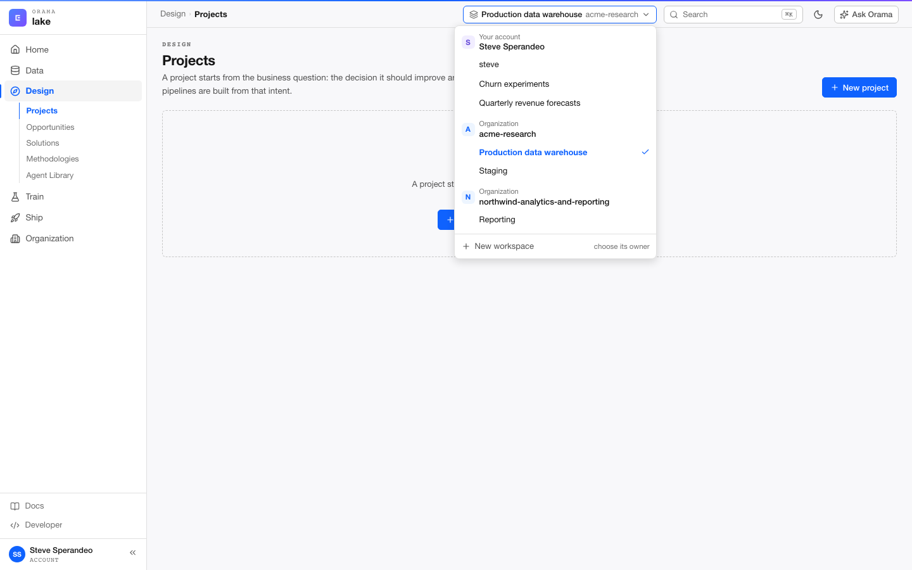

# Workspace Selection and Navigation

**What.** Design, Train, Ship and Ask Orama work in one workspace of one account, and the page URL
says which: `/w/<workspace_id>/design/projects`. The top bar's picker changes it. Everything else
(repositories, organizations, account pages, Services, Deployments, Workspaces) is outside `/w/`
and names its account or workspace in its own input.

**Why the URL.** The address is the whole context: it can be bookmarked, shared and opened in two
tabs at once with two workspaces, and the capability calls a page makes follow from it. Before
lake#561 the server remembered the choice in a `lake_workspace` cookie and rewrote every link and
form into `/w/<id>/`; both are gone.

## The URL

- **A workspace page** (`workspace: true` in its `routes.ts`) answers at `/w/<workspace_id><path>`.
  Its query parameters are unchanged (`/w/<id>/design/project?name=churn`).
- **Its unprefixed address** (`/design/projects`, from an old link or the docs) opens the same page
  in the current workspace (below). Only a person who can reach no workspace at all sees *Choose a
  Workspace* with a link to Workspaces. A visitor is sent to sign in (`WorkspaceRedirect` in
  `src/App.tsx`).

## The current workspace, and a deleted one

`resolveWorkspace` in `lib/workspacePicker.ts`, called by `lib/session.tsx` (lake#638):

- the URL's `/w/<id>` when it is live in one of the person's accounts;
- else the `viewer` read's `workspace_id` when live, else the remembered one when live, else the
  person's own first workspace, else the first workspace any organization of theirs has.

So a workspace deleted since it was linked or remembered never leaves the app on *Choose a
workspace* while another exists (Steve, 2026-10-11: the review organization's only workspace was
deleted and the picker read "ux-review-2026… / Choose a w…"). Once the `viewer` read has settled
(not while it is being fetched again, so a workspace made a moment ago is not taken for a deleted
one), the session stores the fallback in `lake-workspace` and, when the URL named the deleted
workspace, replaces `/w/<deleted>` with `/w/<fallback>` keeping the rest of the path and the query.
- **`/w/<workspace_id>` and `/w/<workspace_id>/`** open the workspace's home,
  `/w/<workspace_id>/design/projects`, keeping the query.
- **The rail** marks the current item by the path without its `/w/<id>` prefix (`localPath` in
  `routes.tsx`), and its Design, Train and Ship links carry the current prefix.

## Only `/w/` pages scope API calls

`src/lib/session.tsx` sets the prefix from the page URL, and `src/lib/api.ts` sends every
capability called from a `/w/<id>/` page to `/w/<id>/v1/<name>`. Lake fills `workspace_id`
from that prefix and answers `invalid_input` when the input names a different one
([../serving/http.md](../serving/http.md#workspace-api-prefix)). A page outside `/w/`
calls `/v1/<name>` unprefixed, whatever workspace was used last, and passes `customer_id` or
`workspace_id` itself where the capability needs one (the Workspaces page, Services, the
repository create form, Drive sharing, secret mounts).

## The remembered workspace

The browser keeps the last workspace it opened under `/w/` in `localStorage["lake-workspace"]`.
It is navigation memory only:

- it chooses where an unprefixed workspace link goes, and which workspace the rail's links open
  from a page outside `/w/`;
- it is sent as `workspace_id` to the `viewer` read, which accepts it only when it is live in one
  of the caller's accounts and otherwise answers that account's only workspace, or none
  ([../api/web-app.md](../api/web-app.md#viewer));
- it never scopes an API call and is never a credential. Clearing it changes nothing a capability
  does.

## The picker

`components/WorkspacePicker.tsx`, shown to a signed-in viewer with at least one account; its rules
are pure functions in `lib/workspacePicker.ts` (lake#638).

- **The pill** names the current workspace first, in full where it fits. When the viewer has more
  than one owner (their account and an organization, or several organizations) the owner follows,
  muted: *Your account* for their own account, else the organization's name. A name cut short keeps the
  whole of it in the tooltip (`Production — acme-research (Organization)`). At phone width the pill
  shows the workspace name alone, cut to fit, and its menu is a sheet across the screen.
- **The menu** groups the workspaces by owner. Each group's header is an initial, a small kind label
  (*Your account* or *Organization*) and the owner's name as written, in the regular face: the
  person's own name for their account (never its generated handle), the organization's name
  otherwise. Workspaces are listed by name (names are unique among an owner's live workspaces; the
  environment is on Workspaces, lake#452), pending and stopped ones included; an owner with none
  says *No workspaces yet*. When the URL names no workspace the pill reads *Choose a workspace*.
- **Long lists.** The list scrolls inside the menu. With more than eight workspaces across owners
  (`FILTER_AFTER`) the menu opens with a filter box, focused: a workspace stays when its name or its
  owner's name contains every word typed (case and accents ignored), an owner with nothing left is
  hidden, and Enter opens the first one left.
- Choosing a workspace keeps the page: a workspace page reopens at the same path and query under
  the new workspace; any other page opens the new workspace's Projects.
- **New workspace** is one action at the menu's foot. It opens
  `/workspaces?customer_id=<current owner>&new=1`, whose dialog asks for the **owner** (your
  account or an organization you belong to) when there is more than one, then the name and the
  environment.

Screenshots at 1440 and 390 wide, from mocked answers (one account with three workspaces, two
organizations, a second viewer with twelve workspaces for the filter, and a third whose remembered
workspace was deleted, with Workspaces grouped by owner), are in
[`screenshots/workspace-picker/`](screenshots/workspace-picker/). Make them again with
`frontend/checks/workspace-picker.mjs` against `npx vite --port 5174` (its header says how); it also
prints whether the page scrolls sideways, the pill's text and tooltip, the group headers, and
whether the filter shows.

### A new account's first workspace

`start_workspace` names an account's first workspace after the account's handle (the person's
handle, or the organization's), so the picker reads a name rather than a placeholder (lake#638). An
account whose first workspace was created earlier as `workspace` keeps that name; lake never renames
it, and it can be renamed from Workspaces ([../api/workspaces.md](../api/workspaces.md)).

## A workspace that is not ready

`components/WorkspaceGate.tsx` wraps Design, Train and Ship content. It reads `workspace_status`
and shows why the page is unavailable (no account, no workspace control plane, a failed status
read), that the workspace Zetta is being prepared (checked again every 15 seconds), that it
failed, or **Start** when it was never started (`start_workspace`). Design → Agents shows Orama's agents
whether or not the workspace is ready, because it is lake's, not the workspace's.

## The Workspaces page

`/workspaces` (`pages/workspaces/WorkspacesPage.tsx`) is outside `/w/` so the first workspace can be
created before one exists. It lists **every workspace the person can reach, grouped by owner** exactly
as the picker groups them (lake#638): their account first, then each organization, each group headed
by its initial, kind and name as written, with the picker's names, order and counts
(`workspaceGroups`, one `list_workspaces` per owner; a workspace being deleted is gone from both). The
figures (Workspaces, Ready, Failed, Storage) cover every owner (`workspaceFigures`). An owner with no
workspace shows a *New workspace* row in its group, which opens the dialog for that owner; the page is
never empty while an owner has one. The search and the phase filter apply across groups.
`?customer_id=` only chooses the owner a new workspace defaults to. `?new=1` opens its New Workspace dialog (the picker's *New workspace*),
which asks for the owner when the viewer has more than one. **Rename** on a row renames the workspace
(`update_workspace {name}`); its data, address and namespace stay. Figures on top count the chosen customer's workspaces, the ready and
failed ones and the storage they request; the list shows each workspace's name, environment and
namespace, its phase as a state chip, its storage (requested, and observed when it differs) and its
age, with a search and a filter by phase. **New workspace** opens a dialog that creates one from a
name and an environment (`create_workspace`; `dev`, `staging`, `prod` or a lowercase DNS label). It
writes desired state; the operator provisions the namespace and Zetta.

**Delete** opens a confirmation dialog (`/workspaces?customer_id=…&delete=<workspace_id>`, so the
address still opens it). It first reads `delete_workspace {dry_run: true}` and lists what goes with
the workspace, with counts: its Zetta and every record in it, its repositories (live, and deleted
but still retained), its apps, its unfinished builds and its images, each by name under "Everything
by name". It says the deletion cannot be undone and asks for the workspace's name; a wrong name is
refused by the capability and shown on the field ([deletion](../api/workspaces.md#deletion),
lake#514). Cancel or Escape closes it and drops `delete=`.

### Settings

**Settings** on a row opens the workspace's settings dialog (lake#1230). Today it holds one choice,
**Agent model**: the model every agent working in the workspace uses. It reads
`get_workspace_settings` and lists each chat model this Lake serves as a choice, with its price per
million tokens from the price list in force ("$2.60 in, $13.00 out per million tokens") and, for a
model with long-context rates, a second line with the price of a prompt over 272,000 tokens. The
default is labelled "gpt-6.1-sol (default)" and is the one selected while the workspace has chosen
none. Where billing is off or no rate is published, the line says "No price published on this Lake",
never $0. **Save** (enabled once the choice differs from the model in effect) calls
`set_workspace_settings`; choosing the default sends `agent_model: null`, so the workspace keeps
following the default. A person who may only read the workspace sees the choice, and the save answers
the refusal on the dialog. The labels, prices and what is sent are pure functions in
`src/lib/agentModels.ts`, tested by `tests/agent-models.test.ts`
([../api/workspaces.md](../api/workspaces.md#settings)).

## How to verify

- Open `/design/projects` signed in with one workspace: the address becomes
  `/w/<id>/design/projects`. With two workspaces and no remembered one, the page asks.
- In the Network panel, a call from `/w/<id>/train/data` goes to `/w/<id>/v1/…`, and a call from
  `/repositories` goes to `/v1/…`, after either order of visits.
- Switch workspace on `/w/<a>/train/runs?project=x`: the page reopens at `/w/<b>/train/runs?project=x`.
- Clear `localStorage` and reload a `/w/<id>/` page: it opens the same workspace.
- `HttpServer/HttpResponseIsolation.TheViewerSaysWhoIsSignedInAndWhereTheyAre` checks the `viewer`
  read's workspace validation.
- On `/workspaces`, open **Settings** on a workspace: every served chat model is listed with its
  prices, gpt-6.1-sol selected and marked default; choose another and Save, reopen it, and it is
  selected (`npm test` runs `tests/agent-models.test.ts`).

## How to change

A page that works in a workspace sets `workspace: true` in its `routes.ts` and builds its links
with `workspacePath` (or the page group's `ws(...)` helper). Never read `lake-workspace` to decide
what a capability call is about; take the workspace from the URL. A new top-level path prefix that
holds workspace pages is added to `isWorkspacePath` in `routes.tsx`.

The storage rule, migration, retention and cross-repository follow-ups are in the
[workspace data-plane design](../architecture/workspace-data-plane.md).
